# Program Manager 3.1 for .NET

An independent C# and .NET 10 recreation of the Windows 3.1 Program Manager. The application is a custom WinForms implementation: window chrome, menus, dialogs, buttons, scroll bars, and icons are drawn by the project itself rather than by the modern Windows theme. Text entry uses the platform edit control internally, styled to match the period.

The goal is to reproduce the look and behavior of the original Program Manager:

- 3D window frames, navy active title bars, white inactive title bars, and 18-pixel title and menu bars
- File, Options, Window, and Help menus with keyboard mnemonics
- Program groups as child windows on a gray desktop
- Minimized groups shown as labeled group icons
- Program items with 32x32 icons, labels, selection, keyboard navigation, and drag-and-drop
- Group and program properties, move/copy, run, new-object, icon-picker, browse, and confirmation dialogs
- Clock, Clipboard Viewer, Print Manager, Help, and About accessory windows

## Screenshots

### Main window

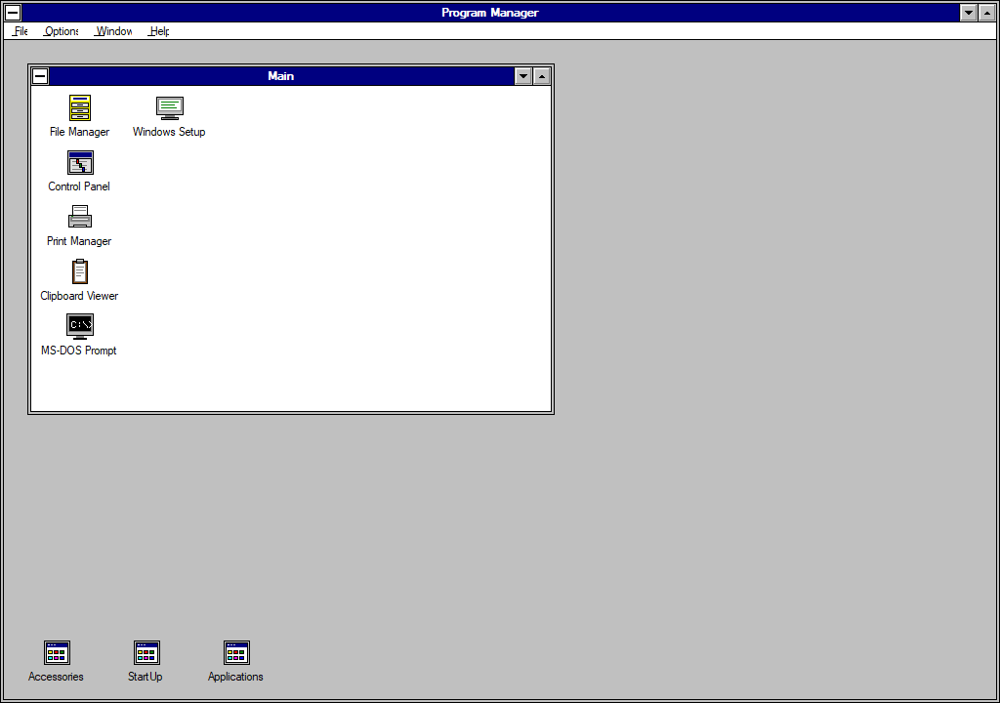

The File menu, with the original command set:

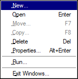

### Dialogs

| Dialog | Preview |
| --- | --- |
| **New Program Object** — choose a program group or a program item | 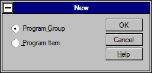 |
| **Program Group Properties** — name a group and its `.GRP` file | 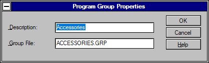 |
| **Program Item Properties** — description, command line, working directory, shortcut, icon | 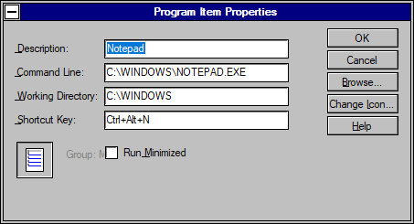 |
| **Move Program** — send a selected program to another group | 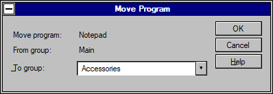 |
| **Change Icon** — pick from the built-in icon set | 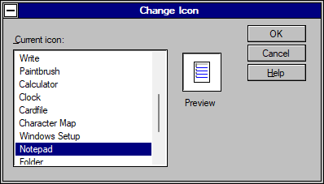 |
| **Run** — start any command line | 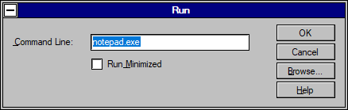 |
| **Browse** — file picker used by Run and program properties | 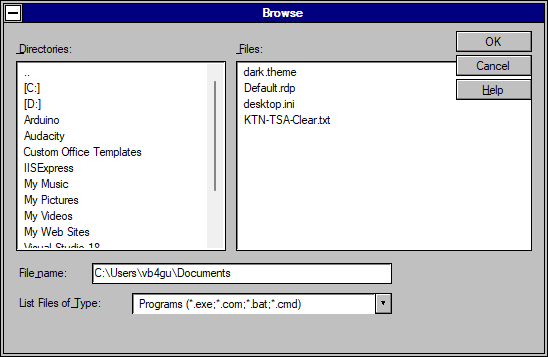 |
| **About Program Manager** | 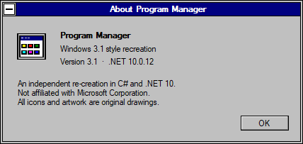 |

### Accessory windows

| Window | Preview |
| --- | --- |
| **Clock** | 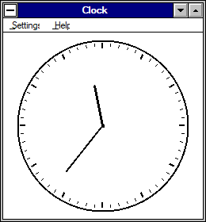 |
| **Clipboard Viewer** | 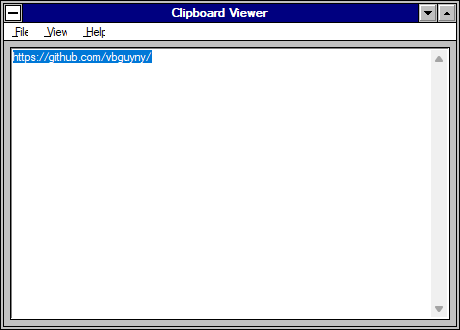 |
| **Print Manager** | 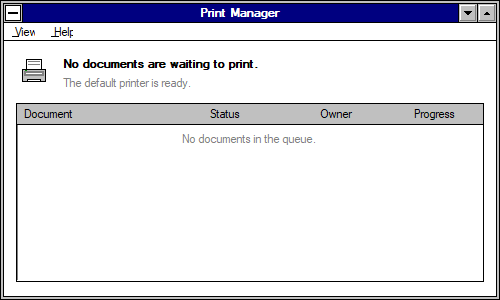 |
| **Help** | 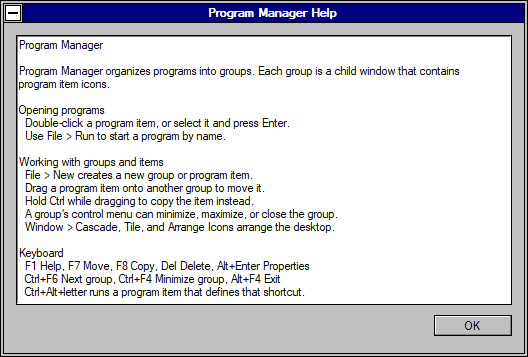 |

All images are generated by the `--screenshot` and `--dialogs` options described under [Development helpers](#development-helpers).

## Requirements

- Windows 10 or Windows 11
- .NET 10 SDK

## Build and run

```powershell
dotnet build
dotnet run
```

The executable is written to `bin\Debug\net10.0-windows\ProgramManager31.exe`.

Use a different data directory for testing or a portable setup:

```powershell
dotnet run -- --data-dir D:\Temp\PM31Data
```

## Using it

- **Open a program:** double-click its icon, select it and press Enter, or use **File > Open**.
- **Select:** click a program item; use the arrow keys to move the selection.
- **Drag a program:** drag an icon onto another group window or onto a minimized group icon. Hold Ctrl while dropping to copy instead of move.
- **Move a group:** drag its title bar. Double-click the title bar to maximize or restore.
- **Resize:** drag any group window border or corner.
- **Minimize/maximize:** use the title-bar buttons or the group's system menu.
- **Menus:** use the mouse, Alt+underlined letter, or arrow keys. Escape closes a menu.
- **File commands:** New, Open, Move (F7), Copy (F8), Delete (Del), Properties (Alt+Enter), Run, and Exit Windows.
- **Window commands:** Cascade, Tile, Arrange Icons, and a list of open groups.
- **Options:** Auto Arrange, Minimize on Use, and Save Settings on Exit.
- **Shortcut keys:** program properties accept Ctrl+Alt+letter or Ctrl+Alt+digit global shortcuts.

## Data and compatibility

Settings and groups are stored in:

```text
%LOCALAPPDATA%\ProgramManager31\
```

- `PROGMAN.INI` stores application settings and the group-file list.
- Each group is a `.GRP` JSON file in the `ProgramManager31.Group` format.

The `.GRP` format is intentionally readable and versioned. It is **not** the binary Windows 3.1 group-file format, and binary `.GRP` files from Windows 3.1 are not imported.

## Development helpers

```powershell
# Run model, layout, menu, window-state, cascade/tile, and drag tests
dotnet run -- --self-test

# Write the main-window screenshot plus a File-menu screenshot next to it
dotnet run -- --screenshot .\docs\screenshots\main.png

# Write screenshots of every dialog and built-in window
dotnet run -- --dialogs .\docs\screenshots\dialogs
```

These two commands regenerate the images used in [Screenshots](#screenshots).

The screenshot and self-test modes use temporary data directories unless `--data-dir` is also supplied.

## About the reconstruction

This is an independent educational recreation. It uses no Microsoft source code or binaries from Windows 3.1. It was built with the Reverse Engineer Anything workflow, but no original `PROGMAN.EXE` was available in the target environment. The visual design was reconstructed from reference screenshots of Windows 3.1 Program Manager and from publicly documented behavior. All icons and pixel artwork in this repository are original drawings.

Windows and Windows 3.1 are trademarks of Microsoft Corporation. This project is not affiliated with or endorsed by Microsoft.

## License

Released under the [MIT License](LICENSE).
